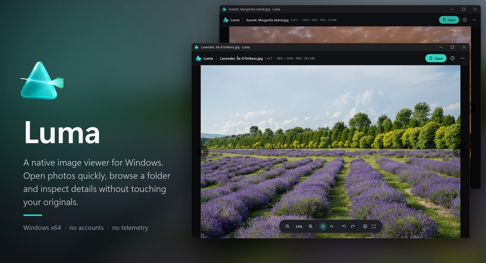
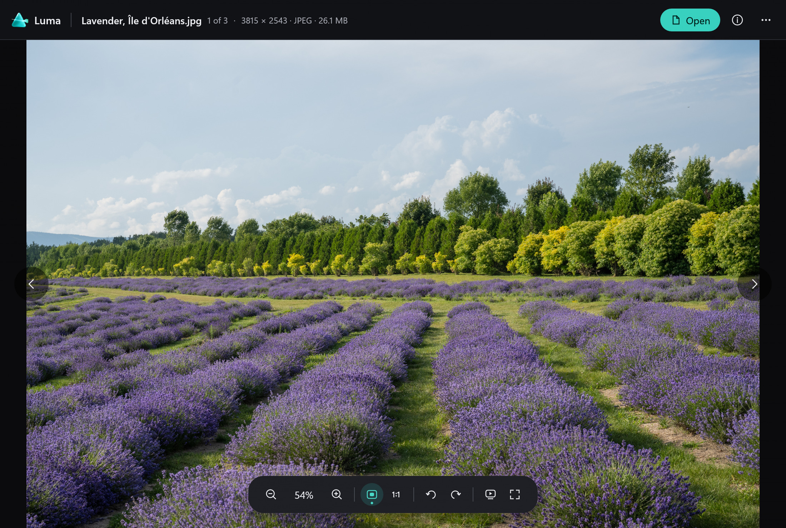
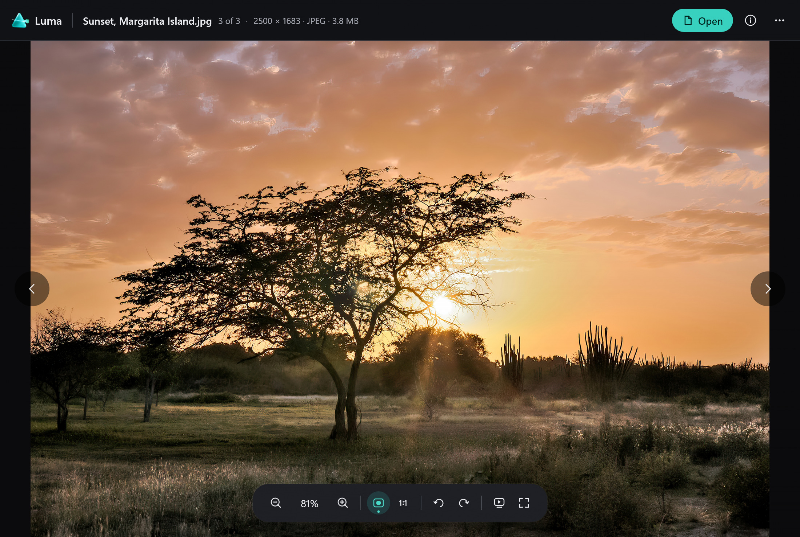
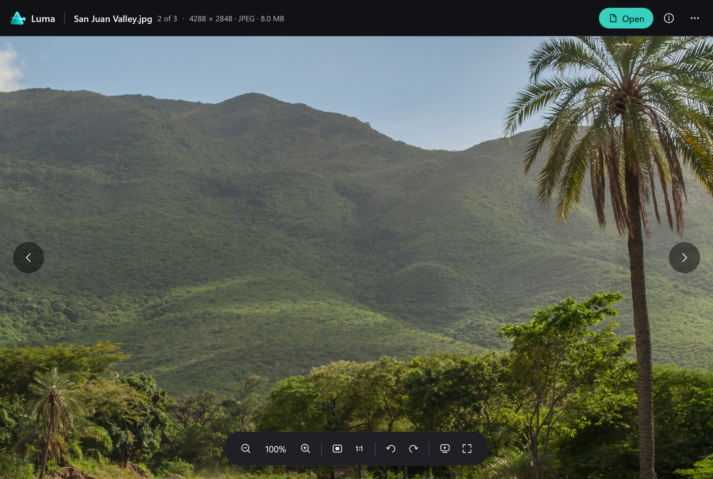
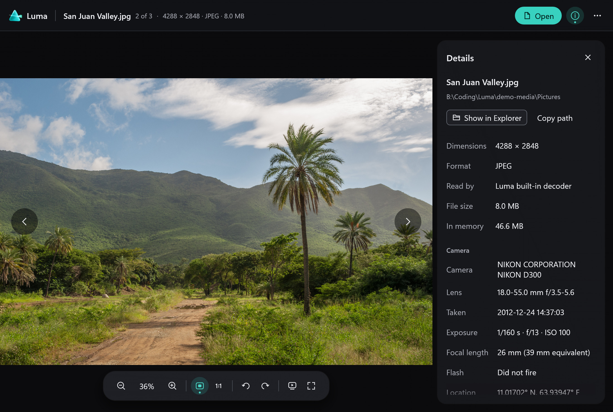

  

Luma is a native image viewer for Windows. It opens a photo straight away, steps through the rest of
the folder, zooms at the pointer and shows the camera details, without ever changing your originals.
No account, no telemetry, no background service.

**[Download Luma 0.2.1](https://github.com/v2matosevic/Luma/releases/latest)** (installer 3.6 MB)
· [Install](docs/INSTALL.md) · [User guide](docs/USER-GUIDE.md) · [Formats](docs/FORMATS.md)
· [Build](docs/BUILD.md) · [Verification](docs/VERIFICATION.md)

The picture above is a mockup built from the scenes below. Every picture, and the photographs
behind it, is explained in [docs/MEDIA-CREDITS.md](docs/MEDIA-CREDITS.md).

## What it does

- Opens JPEG, PNG, BMP, TIFF, GIF, WebP, animated WebP/APNG and still AVIF on its own.
- Uses the codecs already installed in Windows for HEIC/HEIF, DNG, camera RAW, JPEG XR and JPEG XL, and never installs one for you.
- Zooms at the pointer, pans, rotates the view, shows 1:1 pixels, plays a slideshow and animations.
- Reads EXIF: camera, lens, exposure, time and location, in a details card.
- Reads ahead in the direction you are browsing, copies the picture or its path, and opens Explorer.
- Light, dark and follow-Windows themes.

## Install in a minute

1. Download `Luma-0.2.1-Setup.exe` from the [latest release](https://github.com/v2matosevic/Luma/releases/latest).
2. Run it. Luma installs for your user only, needs no administrator account and appears in Start under Version2.
3. Open a photo from the app, or drag one onto the window. The Open with option is off unless you tick it.

Prefer no installer? Download the portable ZIP (5.9 MB), extract every file into a fresh folder and
run `luma.exe`. The builds are unsigned, so compare the download with `SHA256SUMS.txt` first:
`Get-FileHash -Algorithm SHA256 <file>`. More in the [installation guide](docs/INSTALL.md).

Windows 10 or 11 on x64 with an OpenGL-capable graphics driver. Development verification used Windows 11.

## A look inside

These are scenes drawn by Luma's own interface and decoder from real photographs, captured offscreen
at 200% display scale: the name, size, format, camera, lens and exposure are read from the files
themselves. Which photo is open, the zoom and the details card are staged. They are not photographs
of a running window. The three photographs are by Wilfredor, published as CC0. Credits and licenses
are in [docs/MEDIA-CREDITS.md](docs/MEDIA-CREDITS.md).

Browse. The header names the file, its place in the folder, its size and format. This 38 megapixel
JPEG is shown from a scaled preview, as Luma does for very large baseline JPEGs.

Step through the folder with the arrows, Left/Right or PgUp/PgDn.

Zoom with the mouse wheel at the pointer, or press 1 for actual pixels. This is 100% of a
4288 x 2848 photo, at the screen's real pixels.

Details (key `I`): file facts and the camera's own EXIF. Luma reads the file and does not write to it.

## Formats and limits

JPEG, PNG, BMP, TIFF, GIF, WebP, animated WebP/APNG and still AVIF are built in, with bounded pixel
and frame counts. HEIC/HEIF, DNG, camera RAW, JPEG XR and JPEG XL depend on the Windows codecs on your
PC: HEIC may need Microsoft's HEIF and HEVC extensions, and not every camera RAW model or JPEG XL file
was verified. Large baseline JPEGs (over 24 megapixels) are shown from a scaled preview. HDR and
full-depth display output are not promised. Details are in [docs/FORMATS.md](docs/FORMATS.md); what was
checked, and what was not (physical input, other graphics hardware), is in
[docs/VERIFICATION.md](docs/VERIFICATION.md).

## License and contributing

First-party code and original artwork are MIT licensed. Dependencies retain their licenses
([License](LICENSE), [third-party terms](docs/LICENSING.md)). The photographs used in the README are
CC0 by their photographer ([media credits](docs/MEDIA-CREDITS.md)). Luma is an independent app and
repository: its shared interface source is included here, so building it needs no other repository.
Publisher: Version2. [Contributing](CONTRIBUTING.md) · [Security](SECURITY.md).
